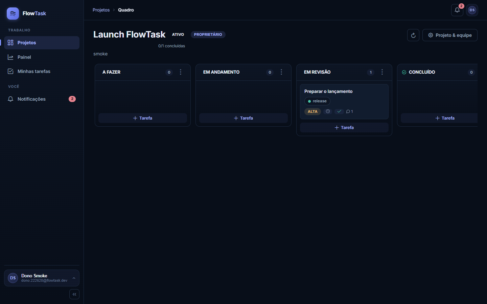
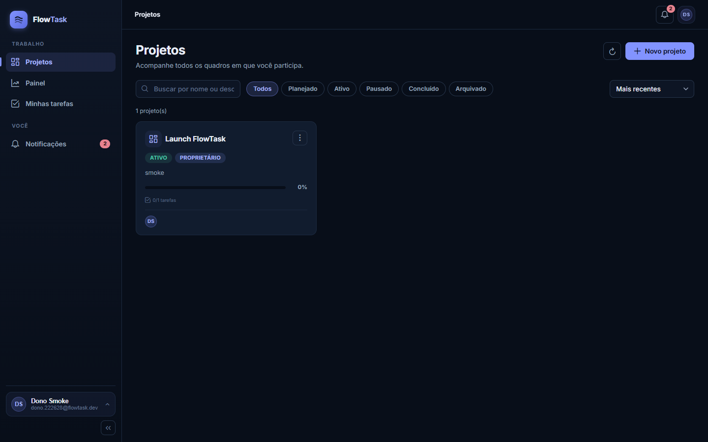
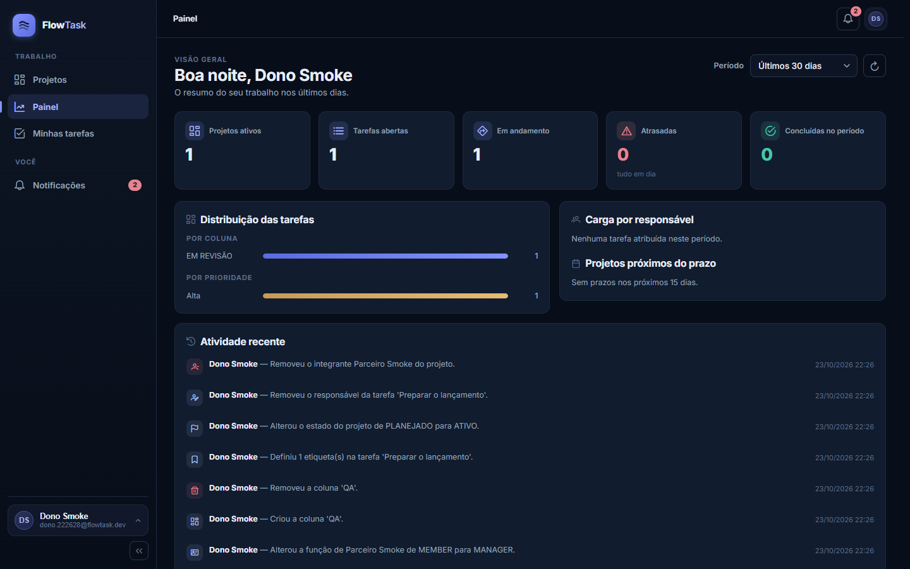
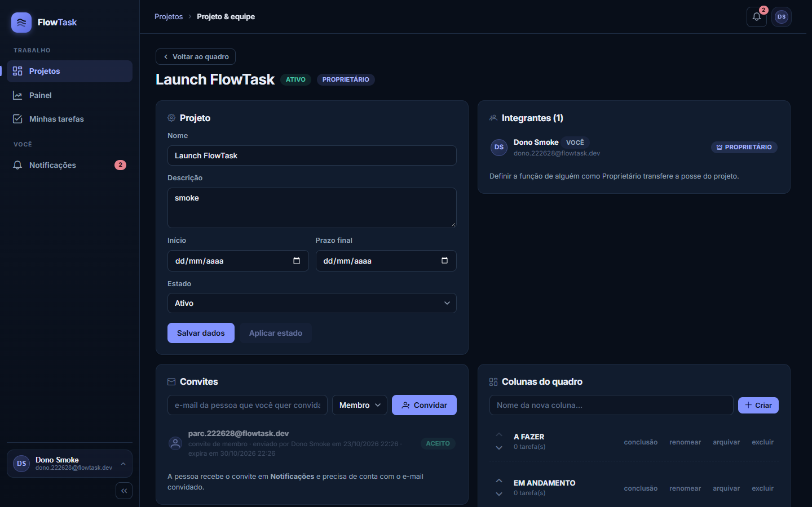
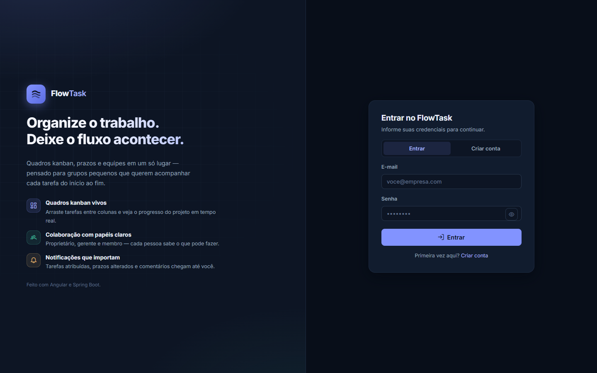
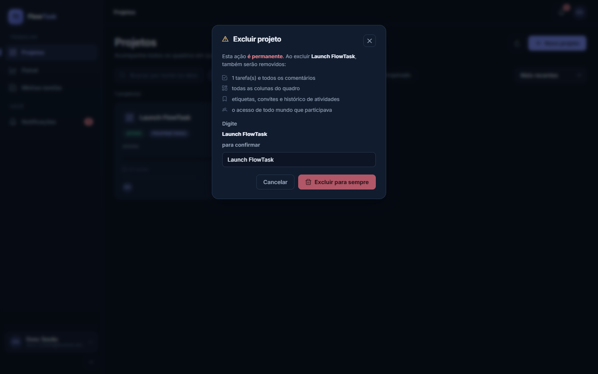

<div align="center">

# FlowTask

**Plataforma de gestão de projetos em equipe com quadro Kanban — papéis, prazos, comentários, notificações
e dashboard, com toda a regra de negócio decidida no servidor.**

[](https://openjdk.org/)
[](https://spring.io/projects/spring-boot)
[](https://angular.dev/)
[](https://primeng.org/)
[](https://www.postgresql.org/)
[](LICENSE)

</div>

---

> **Kanban de verdade, não de fachada.** A autorização é decidida **no backend** (sem vínculo com o projeto
> responde `404`; com vínculo e papel insuficiente, `403` — nunca o contrário). A movimentação de tarefa é
> protegida por **dupla barreira de concorrência** (`SELECT … FOR UPDATE` + `@Version` → `409`), o drag & drop
> do front opera com **rollback otimista** (o cartão volta ao lugar se a API falha) e a exclusão de projeto
> é uma **única transação em cascata**, liberada ao OWNER só depois de digitar o nome do projeto.

## Telas do produto

| **Quadro Kanban (drag & drop persistido)** | **Projetos (progresso e ações)** |
|---|---|
|  |  |
| **Dashboard (7/30/90 dias)** | **Equipe (papéis e convites)** |
|  |  |
| **Entrar / criar conta** | **Exclusão de projeto (digitar o nome)** |
|  |  |

Versões mobile (7 telas), notificações e "minhas tarefas" em [`docs/capturas/`](docs/capturas) — 15 capturas
reais do produto, geradas via Chrome DevTools Protocol (`scripts/captura-cdp.mjs`).

**FlowTask** é uma aplicação full-stack construída como portfólio profissional, com o mesmo rigor de um
produto de verdade:

- **nenhum botão decorativo** — toda ação executa uma chamada real na API e persiste no banco;
- **nenhum dado mockado** — progresso, indicadores, prazos atrasados e carga por responsável vêm de SQL/DTOs;
- **nenhuma falha silenciosa** — erro do backend vira estado de erro com "tentar novamente"; requisição em
  curso vira skeleton; lista sem dados vira estado vazio com a ação sugerida;
- **nenhuma confirmação vaga** — ações destrutivas explicam o que se apaga; o projeto exige **digitar o nome**;
- **histórico fiel** — atividades e notificações sempre com o **ator autenticado**, nunca dados do cliente.

---

## Índice

1. [Demonstração em 60 segundos](#1-demonstração-em-60-segundos)
2. [Visão geral do produto](#2-visão-geral-do-produto)
3. [Arquitetura](#3-arquitetura)
4. [Stack técnica](#4-stack-técnica)
5. [Funcionalidades](#5-funcionalidades)
6. [Modelo de permissões](#6-modelo-de-permissões)
7. [Exclusão de projeto — o caso mais sensível](#7-exclusão-de-projeto--o-caso-mais-sensível)
8. [Concorrência no quadro](#8-concorrência-no-quadro)
9. [Modelo de dados](#9-modelo-de-dados)
10. [Pré-requisitos](#10-pré-requisitos)
11. [Instalação e execução](#11-instalação-e-execução)
12. [Variáveis de ambiente](#12-variáveis-de-ambiente)
13. [Referência da API](#13-referência-da-api)
14. [Testes](#14-testes)
15. [Segurança](#15-segurança)
16. [Identidade visual — design system v2](#16-identidade-visual--design-system-v2)
17. [Estrutura do repositório](#17-estrutura-do-repositório)
18. [Decisões técnicas](#18-decisões-técnicas)
19. [Limitações conhecidas](#19-limitações-conhecidas)
20. [Roadmap](#20-roadmap)
21. [Solução de problemas](#21-solução-de-problemas)
22. [Licença e créditos](#22-licença-e-créditos)

---

## 1. Demonstração em 60 segundos

Depois de instalado (§11), o caminho mais curto para ver tudo funcionando:

```text
1. Abra http://localhost:4200 → "Criar conta" (senha: 8+ caracteres, 1 letra e 1 número);
2. "Novo projeto" → o quadro abre com 4 colunas padrão:
   A FAZER · EM ANDAMENTO · EM REVISÃO · CONCLUÍDO;
3. "Adicionar tarefa" em A FAZER: título, prioridade (BAIXA → CRÍTICA), prazo, etiqueta #RRGGBB;
4. Arraste o cartão para EM ANDAMENTO → o PATCH persiste no backend;
   se a chamada falhar, o cartão volta à posição original e um toast explica o erro;
5. Marque CONCLUÍDO como "coluna de conclusão" e arraste a tarefa para lá → concluída;
   devolva-a para outra coluna → reaberta automaticamente;
6. Equipe → convide um e-mail JÁ cadastrado (validade de 7 dias);
   a outra conta aceita em Notificações → entra como MEMBER;
7. O novo membro comenta na sua tarefa → o sino sobe na próxima consulta;
8. Dashboard e Painel do projeto: distribuição por coluna e prioridade, carga por responsável,
   prazos dos próximos 15 dias e atividade recente — tudo calculado no backend;
9. Feche o ciclo: "Excluir projeto" mostra O QUE será perdido e exige digitar o nome do projeto;
   nome errado → botão fica desabilitado; nome certo → uma transação apaga tudo e o card
   some da listagem.
```

O fluxo foi automatizado em duas suítes de fumaça contra a API real: `scripts/smoke-e2e.ps1`
(33 verificações — autenticação, papéis, quadro, tarefas, convites, dashboard) e
`scripts/smoke-delete.ps1` (9 verificações da exclusão — `204` OWNER, `403` membro, `404` forasteiro,
cascata e remoção da listagem), ambas verdes neste projeto.

---

## 2. Visão geral do produto

1. O usuário **cria uma conta** (produto todo em PT-BR; política de senha idêntica no front e no back).
2. O **primeiro projeto** recebe as colunas padrão **A FAZER / EM ANDAMENTO / EM REVISÃO / CONCLUÍDO** — e qualquer projeto pode ter colunas criadas, reordenadas, renomeadas, arquivadas ou excluídas (se vazias) pelo OWNER, com uma delas marcada como **coluna de conclusão**.
3. Tarefas recebem **título, descrição, prioridade, prazo, responsável e etiquetas**; mover o cartão para a coluna de conclusão conclui (e devolver reabre).
4. A equipe entra por **convite por e-mail** (exige conta com o mesmo e-mail; expira em 7 dias). OWNER pode trocar funções, remover e **transferir a propriedade**.
5. Colaboração por **comentários** (cada um edita/apaga os seus; OWNER pode apagar qualquer), **etiquetas coloridas** e **histórico por projeto e por tarefa**.
6. **Notificações** com sino e contagem de não lidas para atribuição, prazo, prioridade, conclusão, convites, remoção do projeto e transferência de propriedade.
7. **Dashboard global** (7/30/90 dias) e **painel do projeto** com distribuições, carga por responsável e prazos próximos — agregados calculados no servidor.

O leitor crítico percebe a proposta em uma frase: **a UI nunca decide nada de importante — ela apresenta decisões do backend.**

---

## 3. Arquitetura

```
┌───────────────────────────────┐     JSON + Bearer JWT      ┌─────────────────────────────────┐
│   Front-end (Angular 20)      │ ─────────────────────────► │   Back-end (Spring Boot 3.5)    │
│   standalone + signals        │ ◄───────────────────────── │   Java 21 · 11 controllers      │
│                               │      /api/** via proxy     │   54 rotas mapeadas             │
│   telas: entrar, projetos,    │                            │    ├─ controllers (sem regras)  │
│   quadro, equipe, painel,     │                            │    ├─ services (regras + TX)    │
│   minhas tarefas, notificações│                            │    ├─ repositórios JPA          │
│                               │                            │    ├─ Flyway (schema versionado)│
│   PrimeNG (tema próprio)      │                            │    ├─ TratadorExcecoes → ApiError│
│   @angular/cdk drag & drop    │                            │    └─ segurança JWT + CORS      │
│   tokens --ft-* (styles.scss) │                            │                                 │
└───────────────────────────────┘                            └────────────────┬────────────────┘
                                                                             │ JPA / Flyway
                                                              ┌──────────────▼──────────────┐
                                                              │      PostgreSQL 16+         │
                                                              │  11 tabelas · 9 índices     │
                                                              │  HikariCP (pool 10)         │
                                                              └─────────────────────────────┘
```

### Camadas do back-end (`com.flowtask`)

| Pacote | Responsabilidade |
|---|---|
| `controle` | 11 controllers REST — HTTP, validação e delegação; **nenhuma regra de negócio** |
| `servico` | regras de negócio, papéis, transações (exclusão em cascata), concorrência do quadro |
| `dominio` | entidades JPA e enums (`PapelProjeto`, `PrioridadeTarefa`, `EstadoProjeto`, …) |
| `repositorio` | repositórios JPA (Spring Data) |
| `DTO/` | contratos de entrada e saída — entidades nunca são serializadas |
| `excecao` | `TratadorExcecoes` — erros padronizados; `server.error.include-message: never` |
| `seguranca` | JWT (JJWT), filtro de autenticação, resolvedor de usuário autenticado |
| `config` | CORS por variável, OpenAPI/Swagger, properties tipadas |

### Front-end (Angular 20 standalone)

- **`core/`** — modelos tipados (espelhos dos DTOs), cliente HTTP central, `AuthStore` em *signals* (token em `sessionStorage`), interceptor `Authorization: Bearer` com redirect `401 → /entrar`, guards de rota, `permissoes.ts` (espelho puro das regras do backend, só para UX), toast e sino de notificações.
- **`telas/`** — entrar · projetos · quadro (kanban + gaveta de detalhes) · equipe · painel · minhas tarefas · notificações.
- **`layout/`** — sidebar com seletor de contexto, sino, perfil.
- `styles.scss` — design system (§16) com tokens `--ft-*`.
- `proxy.conf.json` — `/api` → `:8080` no desenvolvimento.

---

## 4. Stack técnica

### Back-end

| Tecnologia | Versão | Uso no projeto |
|---|---|---|
| Java | 21 | Linguagem principal (JDK 24 emitindo bytecode 21 nos testes) |
| Spring Boot | 3.5.7 | Web, Security, Data JPA, Validation, Mail |
| Spring Security + JJWT | 6.5 / 0.12.6 | Autenticação stateless, HMAC-SHA256 |
| PostgreSQL | 16+ | Banco relacional |
| Flyway | (via Spring Boot) | Migrações versionadas — `V1__esquema_flowtask.sql` |
| springdoc-openapi | 2.8.9 | Swagger UI em `/swagger-ui.html` |
| HikariCP | — | Pool de conexões (máximo 10) |
| Spring Boot Mail | 3.5.7 | Envio de convites (opcional, `EMAIL_HABILITADO`) |
| JUnit 5 + Mockito | — | 52 testes de unidade e integração |
| H2 | — | Banco em memória (modo PostgreSQL + Flyway + MockMvc) só nos testes |

### Front-end

| Tecnologia | Versão | Uso no projeto |
|---|---|---|
| Angular | 20.3.34 | Standalone, signals, controle de fluxo nativo |
| TypeScript | 5.8.3 | Tipagem estrita |
| PrimeNG + `@primeng/themes` | 20 | Componentes com tema dark próprio (nada padrão de fábrica) |
| PrimeIcons | 7 | Ícones (sem emojis na interface) |
| @angular/cdk | 20.2.14 | Drag & drop persistido do Kanban |
| RxJS | 7.8 | Fluxos e cancelamento de requisições |
| Karma + Jasmine | 6.4 / 5.7 | 20 specs em ChromeHeadless |
| Inter | — | Tipografia (fallback de sistema em cascata) |

---

## 5. Funcionalidades

### Conta e sessão
- Cadastro com nome, e-mail único e política de senha `^(?=.*[A-Za-z])(?=.*\d).{8,64}$` — **a mesma regex no frontend e no backend**.
- Login com JWT; a sessão expira (8 h por padrão) e o usuário volta ao `/entrar`.
- `GET/PUT /api/auth/me` como fonte de verdade do perfil na UI.

### Projetos
- Listagem com busca, filtro por estado e ordenação; **progresso %** calculado a partir das tarefas concluídas.
- Criação semeia automaticamente as 4 colunas padrão; OWNER edita nome/descrição/datas e muda o **estado do projeto**.
- **Exclusão reservada ao OWNER**, com confirmação digitando o nome e cascata em uma única transação (§7).

### Quadro Kanban
- Colunas: criar, **reordenar** (`PATCH …/columns/reorder`), renomear, **arquivar** e excluir (somente se vazia); marcar a **coluna de conclusão** faz mover para ela concluir a tarefa — e devolver reabrir.
- Cartões recebem título, prioridade, etiquetas, responsável, contador de comentários e um **chip de prazo** que fica no tom de perigo quando vencido (sem pintar o cartão inteiro).
- **Drag & drop** com `@angular/cdk`: a coluna é persistida no backend; em falha o estado otimista volta (§8).

### Tarefas
- Título, descrição, prioridade (BAIXA → CRÍTICA), prazo, responsável e etiquetas `#RRGGBB`.
- Ações granulares: mover (`PATCH …/move`), atribuir, mudar prioridade, mudar prazo, etiquetas e **arquivar**.
- Exclusão de tarefa **bloqueada quando há comentários** — o histórico não se apaga por acidente.

### Papéis e equipe
- OWNER · MANAGER · MEMBER (matriz completa em §6) resolvidos no backend.
- Convite por e-mail com validade de 7 dias; aceitar/recusar pela tela de Notificações; e-mail precisa ter conta.
- Troca de função, remoção de membro e **transferência de propriedade** (somente OWNER).

### Colaboração
- Comentários por tarefa: editar/apagar os próprios; OWNER pode apagar qualquer um.
- Etiquetas por projeto com cor e aplicação N:N nas tarefas.
- Histórico de atividades por projeto e por tarefa, sempre com o ator autenticado.

### Notificações
- Sino com contagem de não lidas; lista com lidas/não lidas e ação que leva ao contexto.
- Eventos: atribuição, prazo, prioridade, concluída, reaberta, convite aceito/recusado, removido do projeto, estado do projeto, transferência.

### Dashboard e painel do projeto
- `GET /api/dashboard/summary?periodo=7|30|90`: projetos ativos; tarefas abertas, em andamento, atrasadas e concluídas no período; distribuição por coluna e por prioridade; carga por responsável; prazos dos próximos 15 dias; atividade recente.
- `GET /api/projects/{id}/dashboard`: o mesmo corte dentro de um projeto.
- Nenhum percentual ou "tendência" inventado: sem dado suficiente para comparar, o indicador simplesmente não mostra variação.

---

## 6. Modelo de permissões

Os níveis são numéricos no código (`OWNER=3 · MANAGER=2 · MEMBER=1`) e toda checagem passa por eles.
O **backend** autoriza; o `core/permissoes.ts` da UI replica a hierarquia apenas para esconder ações
que falhariam — e a falha real, se ocorrer, continua sendo recusada no servidor.

| Ação | MEMBER | MANAGER | OWNER |
|---|:---:|:---:|:---:|
| Ver projeto, quadro, tarefas, comentários e atividades | ✅ | ✅ | ✅ |
| Comentar em tarefas | ✅ | ✅ | ✅ |
| Mover tarefa entre colunas (conclui/reabre) | ✅ | ✅ | ✅ |
| Editar título/descrição de uma tarefa | só as suas* | ✅ | ✅ |
| Criar/editar tarefas (prioridade, prazo, responsável, etiquetas) | ❌ | ✅ | ✅ |
| Convidar pessoas e cancelar convites | ❌ | ✅ | ✅ |
| Editar projeto (nome, descrição, datas) | ❌ | ❌ | ✅ |
| Criar/reordenar/arquivar/excluir colunas | ❌ | ❌ | ✅ |
| Excluir tarefa (bloqueada com comentários) | ❌ | ❌ | ✅ |
| Funções dos membros, remoção e transferência de propriedade | ❌ | ❌ | ✅ |
| Excluir o projeto (digitar o nome) | ❌ | ❌ | ✅ |

\* o próprio responsável pode editar os textos da tarefa dele, mesmo sendo MEMBER — permissão adicional
dada ao `responsavel_id`. A função pura `podeEditarTarefa` (`permissoes.ts`) aplica a regra:
`MANAGER+ OU responsável`.

**Isolamento:** usuário sem vínculo com o projeto recebe **`404`** (o recurso "não existe"); com vínculo
mas papel insuficiente, **`403`**. O histórico e as notificações gravam sempre o **ator autenticado** —
nenhuma rota aceita `usuarioId`/autor do cliente.

---

## 7. Exclusão de projeto — o caso mais sensível

Excluir um projeto apaga colunas, tarefas, comentários, etiquetas, convites, vínculos de membros,
atividades e notificações em **uma única transação**. O fluxo foi pensado para ser explícito nos dois lados:

**No backend** (`DELETE /api/projects/{id}`, a rota nova do redesenho):

```
OWNER autenticado?
 ├─ não tem vínculo ............ 404 (o projeto não existe para você)
 ├─ membro sem papel de OWNER .. 403
 └─ OWNER ..................... 204
     └─ transação única (@Transactional), na ordem do código:
        tarefas (comentários e vínculos cascaram no banco)
        → notificações → convites → membros → atividades
        → projeto (colunas e etiquetas cascadam no banco)
```

**No frontend**, a confirmação é um modal do próprio design system: título com ícone de aviso, a frase
"**Esta ação é permanente**" e a lista do que se perde — "N tarefa(s) e todos os comentários", "todas as
colunas do quadro", "etiquetas, convites e histórico de atividades" e "o acesso de todo mundo que
participava". O campo pede **digitar o nome do projeto** (comparação exata, tolerando apenas caixa e
espaços nas pontas): o botão "Excluir para sempre" fica desabilitado até o texto bater e entra em estado
de carregamento durante a chamada. Nenhum `prompt()`/`confirm()` nativo do navegador entra no fluxo.

Coberta por 9 verificações de fumaça (`scripts/smoke-delete.ps1`) e por testes do
`ServicoProjetoTest` — incluindo o caso "apaga também uma tarefa com comentário".

---

## 8. Concorrência no quadro

Duas pessoas arrastam a mesma tarefa ao mesmo tempo. O que impede silêncio, duelo de escritas e perda de estado:

| Barreira | O que faz |
|---|---|
| `SELECT … FOR UPDATE` | lock pessimista no repositório durante a movimentação — a segunda escrita espera, não corrompe |
| `@Version` (otimista) | escrever sobre a versão antiga devolve **`409`** no `TratadorExcecoes` |
| Rollback otimista na UI | o front atualiza o cartão só após `2xx`; falha → o cartão **volta à coluna de origem** e um toast explica |
| Estado vem do servidor | o quadro nunca "adivinha" a ordem: em falha, volta ao estado anterior entregue pela API |

Resultado prático: nenhum usuário vê o próprio cartão "pular de coluna" com uma promessa que o banco não cumpriu.

---

## 9. Modelo de dados

Schema criado e versionado **exclusivamente por Flyway** (`V1__esquema_flowtask.sql`); o Hibernate roda com
`ddl-auto: none` — **nunca** cria ou altera schema.

**11 tabelas:**

| Tabela | Papel |
|---|---|
| `usuarios` | contas (e-mail único, senha em hash) |
| `projetos` | projeto (nome, descrição, datas, estado) |
| `membros_projeto` | vínculo usuário ↔ projeto com `papel` (OWNER/MANAGER/MEMBER) |
| `convites_projeto` | convites por e-mail, com estado e expiração (7 dias) |
| `colunas_kanban` | colunas por projeto (ordem, arquivada, flag de conclusão) |
| `tarefas` | tarefa (título, descrição, prioridade, prazo, responsável, arquivada, `@Version`) |
| `etiquetas` · `tarefas_etiquetas` | etiquetas `#RRGGBB` e vínculo N:N |
| `comentarios` | comentários das tarefas (autor, textos editáveis) |
| `atividades` | histórico por projeto e por tarefa (ator autenticado) |
| `notificacoes` | eventos por destinatário (não lidas → sino) |

**9 índices** nas consultas que dominam o produto:

| Índice | Tabela | Motivo |
|---|---|---|
| `idx_tarefas_projeto` / `idx_tarefas_coluna` | tarefas | montar o quadro |
| `idx_tarefas_responsavel` | tarefas | "minhas tarefas" |
| `idx_tarefas_prazo` | tarefas | prazos próximos e atrasadas |
| `idx_colunas_projeto` | colunas_kanban | ordenar o quadro |
| `idx_convites_email_estado` | convites_projeto | aceitar convite por e-mail/estado |
| `idx_comentarios_tarefa` | comentarios | gaveta de detalhes |
| `idx_atividades_projeto` | atividades | linha do tempo |
| `idx_notificacoes_destinatario` | notificacoes | sino (não lidas) |

```
usuarios 1─N membros_projeto N─1 projetos
                  │             │        ├─1─N colunas_kanban 1─N tarefas
                  │             │        │                  ├─N tarefas_etiquetas N─1 etiquetas
                  │             │        │                  ├─1─N comentarios
                  │             │        │                  └─1─N atividades
                  │             ├─1─N convites_projeto (por e-mail do convidado)
                  │             └─1─N atividades
                  └─1─N notificacoes (destinatário; não lidas alimentam o sino)
```

---

## 10. Pré-requisitos

| Item | Versão | Observação |
|---|---|---|
| JDK | 21+ (testado com JDK 24) | o build compila com `--release 21` |
| Maven | 3.9+ | o wrapper `mvnw` não está incluído; use o `mvn` local |
| PostgreSQL | 16+ | via serviço local **ou** `docker compose` (§11.1) |
| Node.js | 24 | com npm 10+ |
| Chrome | atual | necessário para a suíte Karma headless |

---

## 11. Instalação e execução

### 11.1 Banco de dados

**Com Docker (é o caminho mais curto):** um único serviço PostgreSQL provisionado pelo `docker-compose.yml`:

```bash
docker compose up -d
# container flowtask-postgres: postgres:18-alpine, banco "flowtask", usuário "flowtask"
# senha: DB_PASSWORD (default "troque-esta-senha") — ajuste no compose ou via .env
```

**Sem Docker:** peça um superusuário e rode `scripts/criar-banco.sql` (resumo):

```sql
CREATE ROLE flowtask LOGIN PASSWORD 'flowtask';
CREATE DATABASE flowtask OWNER flowtask;
```

O esquema (11 tabelas + 9 índices) é aplicado automaticamente pelo **Flyway** no primeiro boot.

### 11.2 Backend — `:8080`

```bash
cd backend
# variáveis são opcionais (os defaults de desenvolvimento estão no §12):
#   DB_URL DB_USER DB_PASSWORD JWT_SECRET JWT_EXPIRACAO_SEGUNDOS CORS_ORIGINS
mvn spring-boot:run
```

- Swagger UI: <http://localhost:8080/swagger-ui.html>
- Testes: `mvn test` (H2 em modo PostgreSQL — não exigem banco instalado; §14)

### 11.3 Front-end — `:4200`

```bash
cd frontend
npm install
npm start        # proxy dev /api → :8080 (proxy.conf.json)
```

### 11.4 Post-instalação (10 segundos)

```text
1. API no ar .............. curl -I http://localhost:8080/v3/api-docs   → 2xx confirma
2. Swagger UI ............. http://localhost:8080/swagger-ui.html
3. Front-end .............. http://localhost:4200 → "Criar conta"
4. Siga a Demonstração em 60 segundos (§1)
```

---

## 12. Variáveis de ambiente

Todas têm default funcional **exceto `JWT_SECRET` em produção** (o default do YAML é um valor de dev
explicitamente marcado como tal no código). Referência completa em `.env.example`; `.env` nunca é versionado.

| Variável | Default (dev) | Descrição |
|---|---|---|
| `DB_URL` | `jdbc:postgresql://localhost:5432/flowtask` | JDBC do PostgreSQL |
| `DB_USER` / `DB_PASSWORD` | `flowtask` / `flowtask` | credenciais do banco |
| `APP_PORT` | `8080` | porta HTTP da API |
| `JWT_SECRET` | valor de dev marcado no YAML | **produção: base64 de 64 bytes aleatórios** (`openssl rand -base64 64`) |
| `JWT_EXPIRACAO_SEGUNDOS` | `28800` (8 h) | validade da sessão |
| `CORS_ORIGINS` | `http://localhost:4200` | origens permitidas, separadas por vírgula |
| `CONVITE_EXPIRACAO_DIAS` | `7` | validade do convite |
| `EMAIL_HABILITADO` | `false` | SMTP dos convites; `false` entrega o convite **dentro do produto** |
| `MAIL_FROM` | `flowtask@localhost` | remetente dos e-mails |

> Em produção o segredo **não deve** estar na linha de comando nem em arquivo versionado: defina `JWT_SECRET`
> no ambiente do processo e `EMAIL_HABILITADO=true` com SMTP real para convites por e-mail.

---

## 13. Referência da API

Autenticação por `Authorization: Bearer <JWT>` em todas as rotas, exceto `register`/`login`.
54 rotas em 11 controllers; referência completa e interativa em `/swagger-ui.html`.

### Autenticação — `/api/auth`

| Método | Caminho | Descrição |
|---|---|---|
| `POST` | `/register` | cria conta (201); **não devolve token** — a sessão nasce no login |
| `POST` | `/login` | devolve o JWT |
| `GET` / `PUT` | `/me` | perfil do usuário autenticado |

### Projetos — `/api/projects`

| Método | Caminho | Descrição |
|---|---|---|
| `GET` | `/` | listagem com busca, filtro por estado e ordenação |
| `POST` | `/` | cria projeto → seed das 4 colunas padrão |
| `GET` / `PUT` | `/{id}` | detalhe / atualização (OWNER) |
| `PATCH` | `/{id}/status` | muda o estado do projeto |
| `DELETE` | `/{id}` | exclui (OWNER; cascata transacional — §7) |

### Quadro — `/api/projects/{id}/columns`

| Método | Caminho | Descrição |
|---|---|---|
| `GET` | `/api/projects/{id}/board` | quadro completo (colunas + tarefas) |
| `GET` / `POST` | `…/columns` | listar / criar coluna |
| `PUT` / `DELETE` | `…/columns/{colunaId}` | atualizar / excluir se vazia |
| `PATCH` | `…/columns/reorder` | reordenar colunas |
| `PATCH` | `…/columns/{colunaId}/archive` | arquivar coluna |

### Tarefas — `/api/projects/{id}/tasks` e `/api/tasks/{id}`

| Método | Caminho | Descrição |
|---|---|---|
| `POST` / `GET` | `/api/projects/{id}/tasks` | criar / listar do projeto |
| `GET` | `/api/tasks/me` | central de "minhas tarefas" |
| `GET` / `PUT` / `DELETE` | `/api/tasks/{id}` | detalhe / edição / exclusão (OWNER; trancada com comentários) |
| `PATCH` | `/{id}` + `/move` `/assignee` `/priority` `/due-date` `/labels` `/archive` | ações granulares |

### Colaboração — comentários, etiquetas, convites e membros

| Recurso | Rotas |
|---|---|
| Comentários | `GET/POST /api/tasks/{id}/comments` · `PUT/DELETE /api/comments/{id}` |
| Etiquetas | `GET/POST/PUT/DELETE /api/projects/{id}/labels` |
| Convites | `POST/GET /api/projects/{id}/invitations` · `PATCH …/{id}/cancel` · `GET /api/invitations/me` · `PATCH /api/invitations/{id}/accept` ou `/decline` |
| Membros | `GET /api/projects/{id}/members` · `PATCH …/{mid}/role` (OWNER transfere) · `DELETE …/{mid}` |

### Consolidados

| Método | Caminho | Descrição |
|---|---|---|
| `GET` | `/api/dashboard/summary?periodo=7|30|90` | dashboard global |
| `GET` | `/api/projects/{id}/dashboard` | painel do projeto |
| `GET` | `/api/projects/{id}/activities` · `/api/tasks/{id}/activities` | histórico |
| `GET` | `/api/notifications` `/count` · `PATCH …/{id}/read` `…/read-all` | notificações |

### Erros

O `TratadorExcecoes` consolida respostas; o Spring não vaza mensagem interna
(`server.error.include-message: never`). Os códigos **significam sempre a mesma coisa do §6**:

| Status | Quando |
|---|---|
| `400` | validação de entrada (DTO) |
| `401` | sem/inválido `Bearer` |
| `403` | integrante, papel insuficiente |
| `404` | não existe **ou sem vínculo** (não revela a existência) |
| `409` | regra violada — inclusive concorrência `@Version` |
| `500` | inesperado — detalhado apenas no log do servidor |

---

## 14. Testes

### Backend — `mvn test` → **52 testes**

| Suíte | Escopo |
|---|---|
| `ServicoJwtTest` · `ServicoAutenticacaoTest` | tokens, expiração, política de senha, registro/login |
| `ServicoProjetoTest` | regras de projeto — incluindo a **exclusão com cascata**, `403`/`404` |
| `ServicoQuadroTest` | colunas: criar, reordenar, arquivar, exclusão se vazia, coluna de conclusão |
| `ServicoTarefaTest` | tarefas: edição granular, prioridade, prazo, etiquetas, lock com `@Version` |
| `ServicoMembrosTest` | papéis, convites, remoção, transferência de propriedade |
| `TratadorExcecoesTest` | formato dos erros (`400/401/403/404/409/500`) |
| `FluxoPrincipalTest` | integração com **H2 em modo PostgreSQL** + Flyway + MockMvc — o de ponta a ponta |

H2 em "modo PostgreSQL" mantém a suíte rápida e determinística sem exigir banco instalado.

### Front-end — Karma + Jasmine (ChromeHeadless) → **20 specs**

```powershell
# Windows: aponte o Chrome para o Karma
$env:CHROME_BIN = "C:\Program Files\Google\Chrome\Application\chrome.exe"
npm test -- --watch=false --browsers=ChromeHeadless
npm run build      # bundle de produção com orçamentos de bundle
```

### Fumaça E2E contra a API real (8080 + 4200)

| Script | Verificações |
|---|---|
| `scripts/smoke-e2e.ps1` | 33 — registro, login, papéis, quadro, tarefas, convites, dashboard |
| `scripts/smoke-delete.ps1` | 9 — exclusão de projeto: `204` OWNER · `403` membro · `404` forasteiro · repetição `404` · cascata (apaga projeto com tarefa + comentário) · saiu da listagem |

---

## 15. Segurança

| Camada | Mecanismo |
|---|---|
| Senha | política `8–64` com letra e número — **mesma regex** no front e no back; nunca devolvida pela API |
| Sessão | JWT HS256 (JJWT) com `JWT_SECRET` por ambiente; 8 h por padrão |
| Transporte | `Authorization: Bearer` injetado por interceptor; `401` devolve ao `/entrar` |
| Autorização | decidida nos **services** do backend; frontend replica para UX (`permissoes.ts`) |
| Isolamento | sem vínculo → `404`; vínculo sem papel → `403`; identidade sempre do contexto de segurança |
| Histórico | ator sempre o autenticado — cliente não escolhe autor de atividade nem notificação |
| CORS | lista explícita por variável (`CORS_ORIGINS`) |
| Erros | `include-message: never` — nada de stack/Mensagem Interna na resposta |

**Checklist de produção:**

- [ ] `JWT_SECRET` com base64 de 64 bytes aleatórios (`openssl rand -base64 64`)
- [ ] `CORS_ORIGINS` restrito ao domínio real
- [ ] API atrás de HTTPS (o front envia o token em toda requisição)
- [ ] `EMAIL_HABILITADO=true` com SMTP real (convites por e-mail)
- [ ] Credenciais de banco com privilégio mínimo no schema `flowtask`
- [ ] `DB_PASSWORD` e `JWT_SECRET` fora de arquivos versionados

---

## 16. Identidade visual — design system v2

Tema dark premium autoral, definido **uma única vez** em `styles.scss` — nenhum preset de fábrica do
PrimeNG exposto sem personalização. Cores semânticas aparecem **apenas** quando há informação real
(prioridade, prazo, estado) — nunca como decoração.

| Token | Valor | Uso |
|---|---|---|
| `--ft-bg` / `--ft-bg-2` | `#080E19` / `#0D1524` | fundo geral / faixa secundária |
| `--ft-surface` / `--ft-surface-2` | `#111C2E` / `#17243A` | cartões / superfícies elevadas |
| `--ft-border` / `--ft-border-soft` | `#26354B` / `#1C2A40` | contornos |
| `--ft-primary` / `--ft-primary-2` / `--ft-primary-deep` | `#8293FF` / `#A5B4FC` / `#5B6BE0` | ações primárias, foco, seleção |
| `--ft-text` / `--ft-text-2` / `--ft-text-3` | `#E8EDF7` / `#96A4BA` / `#5F6F8A` | texto principal / apoio / discreto |
| `--ft-success` / `--ft-warning` / `--ft-danger` | `#49C6A8` / `#E6BB73` / `#E7838F` | concluído · prazo em alerta · atrasado e ações destrutivas |
| `--ft-r-s/m/l` | `8 / 12 / 16 px` | raios (pill = 999 px) |
| `--ft-transicao` | `160 ms` | microinterações (240 ms para painéis) |

- **Tipografia:** Inter com fallback de sistema, em escala consistente de 11 a 34 px.
- **Ícones:** PrimeIcons em todos os componentes — **nenhum emoji** na interface.
- **Acessibilidade:** foco visível com `--ft-shadow-glow`, `color-scheme: dark`, contraste calibrado,
  labels associados aos campos, atributos `aria` nos controles de ícone e `prefers-reduced-motion`
  respeitado globalmente.
- **Estados primeiro:** skeleton durante carregamento, `.vazio` orientado com a ação sugerida, erro
  com "tentar novamente" — em todas as telas que consultam o backend.
- Portfólio de telas de referência em [`docs/capturas/`](docs/capturas) (desktop e mobile).

---

## 17. Estrutura do repositório

```
flowtask/
├── backend/
│   ├── pom.xml
│   └── src/
│       ├── main/java/com/flowtask/
│       │   ├── controle/        (11 controllers REST)
│       │   ├── servico/         (regras, papéis, transações, concorrência)
│       │   ├── dominio/         (entidades JPA e enums)
│       │   ├── repositorio/ DTO/ excecao/ seguranca/ config/
│       ├── main/resources/
│       │   ├── application.yml
│       │   └── db/migration/V1__esquema_flowtask.sql   (11 tabelas · 9 índices)
│       └── test/java/com/flowtask/                     (8 suítes · 52 testes)
├── frontend/
│   ├── package.json · proxy.conf.json · angular.json
│   └── src/
│       ├── app/core/      (models espelhos dos DTOs, API, AuthStore, interceptor, guards,
│       │                   permissoes.ts, toast, sino)
│       ├── app/telas/     (entrar · projetos · quadro · equipe · painel · minhas tarefas ·
│       │                   notificações)
│       ├── app/layout/    (sidebar · sino · perfil)
│       └── styles.scss    (design system v2 — tokens --ft-*)
├── scripts/
│   ├── criar-banco.sql       (role + database)
│   ├── smoke-e2e.ps1         (fumaça da API — 33 verificações)
│   ├── smoke-delete.ps1      (fumaça da exclusão — 9 verificações)
│   └── captura-cdp.mjs       (gera docs/capturas/*.png via CDP)
├── docs/capturas/            (15 capturas reais — desktop e mobile)
├── docker-compose.yml        (PostgreSQL para o desenvolvimento)
├── .env.example · .gitignore
├── LICENSE                   (MIT)
└── README.md
```

---

## 18. Decisões técnicas

1. **Autorização decide no backend.** Sem vínculo → `404` (não revela existência); vínculo sem papel →
   `403`. O frontend replica as regras em `permissoes.ts` **somente para UX**; nenhuma "permissão" da UI
   é fonte de verdade.
2. **Dupla barreira de concorrência.** `SELECT … FOR UPDATE` + `@Version` → `409` (§8), com rollback
   otimista na UI. Mais simples do que fila/event sourcing, e correto no problema real do kanban.
3. **Exclusão de projeto em uma transação só.** `@Transactional` na ordem do código: tarefas → notificações →
   convites → membros → atividades → projeto; colunas, etiquetas, comentários e vínculos cascadam no banco.
   Ou apaga tudo consistente, ou não apaga — nunca meio estado.
4. **Tarefa não excluível com comentários.** Histórico não se destrói por acidente; a regra está
   no backend e também refletida na UI.
5. **Esquema 100% Flyway** com `ddl-auto: none` — Hibernate nunca altera schema; a migração é versionada.
6. **Registro não devolve token.** A sessão nasce no login: menos contexto de autenticação na criação e
   um fluxo único e claro.
7. **JWT em `sessionStorage`** (escopo desta SPA): fechar a aba encerra a sessão; o interceptor injeta o
   Bearer e o `401` devolve ao `/entrar`.
8. **Convite entregue no produto quando não há SMTP** (`EMAIL_HABILITADO=false`): o fluxo completo
   (aceitar/recusar) é testável sem infraestrutura de e-mail — e o contrato com SMTP real é só trocar a flag.
9. **`@angular/cdk` para o drag & drop** em vez de solução caseira: sem animações pesadas, acessível por
   teclado, e a persistência é a chamada `PATCH …/move`, com rollback otimista.
10. **Angular standalone + signals + tema PrimeNG próprio**: sem NgModules, tema dark definido por
    tokens `--ft-*` em um único lugar (styles.scss), tipagem estrita (`strict`).

---

## 19. Limitações conhecidas

- **Docker cobre apenas o PostgreSQL.** Backend/front-end rodam fora de containers (requisito do projeto);
  o Dockerfile completo e o `compose` com aplicação ficam no roadmap.
- **Sem recuperação de senha por e-mail** — exige infraestrutura de e-mail transacional; troca de senha
  autenticada não faz parte do escopo atual.
- **Sessão não se renova:** ao expirar (8 h por padrão), o usuário volta ao login — sem refresh token.
- **Upload de arquivos/anexos não faz parte do escopo.** Etiquetas, comentários e prazos cobrem o ciclo
  colaborativo planejado.
- **E-mails reais dependem de SMTP configurado**; sem ele, o convite é entregue dentro do produto (§18.8).

---

## 20. Roadmap

Em ordem de prioridade natural:

- [ ] **CI no GitHub Actions** — `mvn test` e `ng test`/build a cada push
- [ ] **Docker completo** — Dockerfile do backend/front e `compose` com a aplicação
- [ ] **E2E de navegador** (Playwright) para o kanban (arrastar, gaveta, exclusão digitando nome)
- [ ] Notificações por **e-mail** (mesma maquinaria de eventos, novo canal)
- [ ] **Recuperação de senha** via SMTP
- [ ] Anexos em tarefas
- [ ] Tema claro alternativo derivado dos mesmos tokens

---

## 21. Solução de problemas

| Sintoma | Causa provável | Solução |
|---|---|---|
| `Connection refused` em `:5432` | PostgreSQL parado | `docker compose up -d` ou inicie o serviço do PostgreSQL |
| Flyway falhou no boot | schema divergente ou banco corrompido | recrie o banco (`DROP DATABASE` + `CREATE`); Flyway reaplica a V1 |
| `401` em toda requisição | token expirado (8 h) ou `JWT_SECRET` mudou entre sessões | entre novamente; se persistir, confirme o `JWT_SECRET` do backend |
| `403` em ação que antes funcionava | seu papel no projeto mudou | verifique `GET /api/auth/me` e a tela de Equipe — comportamento esperado |
| `404` constante com recurso existente | usuário sem vínculo com o projeto | isolamento por design (§6) |
| Erro de CORS no console | origem fora da lista | inclua a origem em `CORS_ORIGINS` e reinicie o backend |
| `:4200` ocupada | outro dev server | `npx ng serve --port 4201` + incluir a origem em `CORS_ORIGINS` |
| Karma não abre o Chrome | `CHROME_BIN` apontando errado | `$env:CHROME_BIN = "C:\Program Files\Google\Chrome\Application\chrome.exe"` |
| Convite não chega por e-mail | `EMAIL_HABILITADO=false` | por default o convite fica **dentro do produto** (tela de Notificações do convidado) |
| Sino não zera | notificações ainda não lidas | "marcar todas como lidas" na tela de Notificações |

---

## 22. Licença e créditos

**MIT** — veja [LICENSE](LICENSE). Portfólio: use, adapte e mostre seu trabalho.

Créditos que sustentam este projeto:

- **Spring Boot / Spring Security** pela base de API e autenticação stateless;
- **Angular + @angular/cdk** pela SPA e pelo drag & drop acessível;
- **PrimeNG / PrimeIcons** pela biblioteca de componentes generosa o bastante para ser customizada de ponta;
- **PostgreSQL + Flyway** pelo banco e pelo schema versionado;
- **Inter** pela tipografia;
- **shields.io** pelos badges deste README.

<div align="center">
<sub>Construído com foco em corretude de engenharia e acabamento de produto — permissões no servidor,
concorrência séria e nenhuma tela que finja funcionar.</sub>

**[⬆ Voltar ao topo](#flowtask)**
</div>
